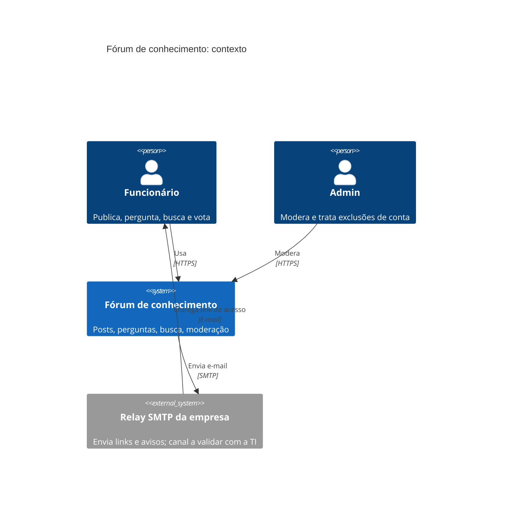
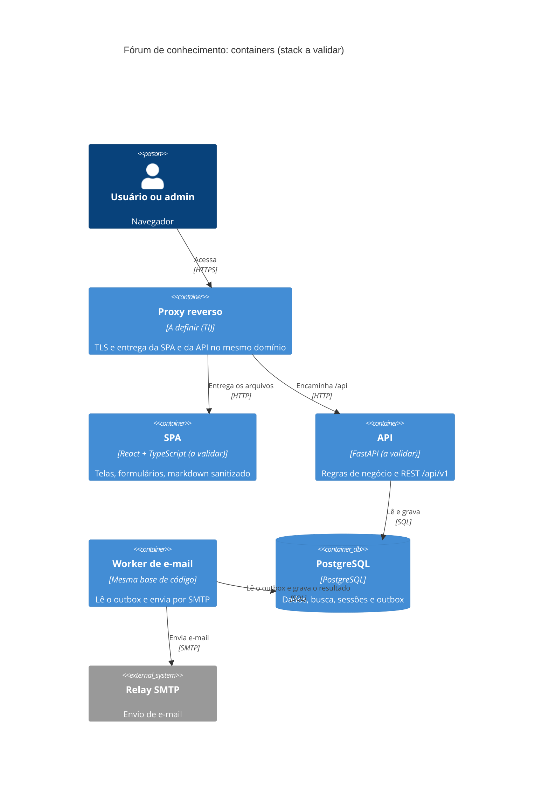

# Arquitetura e API: Fórum interno de conhecimento

- **Status:** Rascunho (todos os ADRs em `Proposto`)
- **Data:** 2026-10-26
- **Origem:** `docs/prd/forum-conhecimento.md` (RF-01 a RF-15, RNF-01 a RNF-06), `docs/planejamento/forum-conhecimento.md` (HU-01 a HU-18 e pendências), `docs/discovery/forum-conhecimento.md`
- **Código existente:** nenhum relevante. `main.py` é um exemplo do PyCharm e o `.zip` na raiz não foi aberto. Não há ADRs anteriores.

## 1. Resumo executivo

Um monolito modular (API + worker de e-mail) sobre um único PostgreSQL, com uma SPA servida no mesmo domínio. Sem senha: o e-mail da empresa, confirmado por link, é a identidade. A busca usa o full-text do próprio PostgreSQL, a fila de e-mail é uma tabela, e a exclusão de conta remove a linha do usuário e deixa o conteúdo sem autor. Nenhum serviço além de PostgreSQL e de um relay SMTP.

Tudo o que não veio do PRD está marcado como **Premissa** (seção 9) ou **Pergunta em aberto** (seção 10).

## 2. Contexto e forças

| Força | Efeito no desenho | Origem |
| -- | -- | -- |
| 50 a 500 pessoas, uso interno | Sem escala horizontal, sem cache, sem fila externa | PRD, seção 1 |
| Time de TI da própria empresa, tamanho e stack não informados | Poucas peças móveis; stack é proposta, não fato | PRD, seção 10 |
| Só e-mail da empresa, confirmado (RNF-01) | Nenhuma rota de conteúdo sem sessão | RF-01 |
| Busca em 2 s para 95% (RNF-02), sem acento e sem diferença de maiúsculas | Full-text no banco, medição de p95 desde o início | RNF-02 |
| Só nome e e-mail; sem jurídico nem DPO (RNF-04) | Sem senha, sem IP armazenado, exclusão real | RNF-04, RF-15 |
| Horário comercial (RNF-03, a confirmar) | Uma instância basta; backup diário, sem alta disponibilidade | RNF-03 |
| Navegadores atuais, 360 px, teclado (RNF-06) | SPA responsiva; acessibilidade é critério de pronto | RNF-06 |

Premissa de volume: não há número de posts nem de buscas por dia. O desenho assume milhares a poucas dezenas de milhares de posts, e isso deve ser validado com teste de carga (seção 7.3).

## 3. Decisão de arquitetura e stack

### 3.1 Estilo: monolito modular (ADR-0001)

| Opção | Ganha | Paga | Reversível? |
| -- | -- | -- | -- |
| **Monolito modular + 1 PostgreSQL (recomendada)** | Um deploy, transações atômicas, operação mínima | Escala em bloco; falha grave derruba tudo | Sim: módulos podem virar serviços |
| Microsserviços | Isolamento e escala por serviço | Rede, deploys e observabilidade múltiplos, sem requisito que peça | Caro de desfazer |
| Monolito por camadas, sem módulos | Começa mais rápido | Moderação, busca e conteúdo se misturam | Refatoração dolorosa |

Revisar se a busca competir por recursos com o resto, ou se surgir outro time dono de uma parte.

### 3.2 Stack (ADR-0002, proposta que depende do time)

| Opção | Ganha | Paga |
| -- | -- | -- |
| **Python/FastAPI + PostgreSQL + SPA React/TS (recomendada)** | Contrato OpenAPI gerado do código; API desacoplada da tela | Dois artefatos (API e SPA) e um build de frontend |
| Django com HTML no servidor | Mais simples de operar, painel admin pronto, sem SPA | Não entrega a API REST pedida; tela acoplada |
| Node/TypeScript no backend e no frontend | Uma linguagem só | Equivalente em custo; só vale se o time for de TypeScript |

Discordo de uma premissa implícita do pedido: para este tamanho, um monolito com HTML no servidor seria ainda mais simples. Mantive a SPA porque o pedido é uma API REST e o RNF-06 pede interface responsiva e acessível; se a TI domina Django e dispensa a API pública, essa opção é melhor e o ADR-0002 deve ser revisto antes do primeiro commit. O contrato da seção 5 vale nas duas.

### 3.3 Visão estrutural





Módulos internos da API (cada um com seus modelos, regras e rotas; um módulo só acessa outro pela interface pública):

| Módulo | Responsabilidade | Atende |
| -- | -- | -- |
| `acesso` | cadastro, links, sessão, papéis, aviso de privacidade, exclusão de conta | RF-01, RF-13, RF-14, RF-15 |
| `conteudo` | posts, respostas, edição, resposta aceita, tags, votos | RF-02, 04, 05, 07 a 10 |
| `busca` | consulta e ordenação full-text | RF-06, RNF-02 |
| `moderacao` | ocultar, restaurar, denúncias, auditoria | RF-11, RF-12 |
| `times` | lista de times e vínculos | RF-03 |
| `email` | outbox e adaptador `EmailSender` | RF-01, RF-12, RF-15 |

`busca` e `moderacao` não tocam tabelas de `conteudo` diretamente, usam a consulta de visibilidade exposta por `conteudo` (um só lugar para a regra "oculto não aparece").

## 4. Modelo de dados

Chaves `uuid`. Tipos exatos e índices finais ficam para a migração (skill `database-migration-plan`).

| Tabela | Campos principais | Observação |
| -- | -- | -- |
| `users` | id, name, email (minúsculo, único), role (`user`/`admin`), email_confirmed_at, privacy_ack_version, privacy_ack_at, created_at | Único dado pessoal: nome e e-mail |
| `auth_tokens` | id, user_id (cascata), purpose (`confirm_email`/`login`), token_hash, expires_at, used_at | Token cru nunca é guardado |
| `sessions` | id_hash, user_id (cascata), created_at, expires_at | Sem IP nem user-agent |
| `teams` | id, name (único sem diferenciar maiúsculas), active | |
| `team_members` | team_id, user_id (cascata) | Vínculo autodeclarado |
| `posts` | id, kind (`post`/`question`), author_id (SET NULL), team_id (opcional), title, body, vote_count, accepted_answer_id, hidden_at, hidden_by, hidden_reason, created_at, updated_at, edited_at, search_vector | `title` e `body` obrigatórios nos dois tipos; `team_id` é nulo quando não há time e só é aceito em `kind=post` (CHECK, premissa da seção 9); `accepted_answer_id` só em `question` |
| `answers` | id, post_id, author_id (SET NULL), body, vote_count, hidden_*, created_at, edited_at | Só para posts `question` |
| `tags` / `post_tags` | slug (único), name; post_id, tag_id | Slug: minúsculo, sem acento, hifenizado |
| `votes` | id, user_id (SET NULL), post_id ou answer_id (exatamente um), created_at | Únicos parciais (user, post) e (user, answer) |
| `reports` | id, reporter_id (SET NULL), post_id ou answer_id, reason, details, status (`open`/`actioned`/`dismissed`), resolved_by, resolved_at | Único parcial (reporter, alvo) |
| `deletion_requests` | id, user_id (SET NULL), status (`pending`/`done`), requested_at, completed_at, completed_by | Sem dados pessoais depois de concluído |
| `audit_log` | id, actor_id (SET NULL), action, target_type, target_id, created_at | Sem texto livre nem e-mail |
| `email_outbox` | id, to_address, template, payload, status, attempts, next_attempt_at, sent_at | Endereço e payload apagados após o envio |

Integridade de transição: a resposta aceita usa chave estrangeira composta (`accepted_answer_id`, `id`) para `answers(id, post_id)`, o que impede aceitar uma resposta de outra pergunta. O voto é uma linha única por usuário e item; o `vote_count` é atualizado na mesma transação da inserção ou remoção, e só se a linha mudou.

## 5. Desenho da API REST

### 5.1 Convenções transversais

- **Base:** `/api/v1`, JSON UTF-8. Evoluir só com mudanças compatíveis; quebra vira `/api/v2`. Como o único cliente é a SPA do próprio projeto, a quebra custa pouco e o plano de depreciação fica `A definir`.
- **Autenticação:** cookie de sessão opaco (`HttpOnly`, `Secure`, `SameSite=Lax`). Todas as rotas exigem sessão (RNF-01), exceto as marcadas "público". Sem token na URL, exceto o do link de e-mail, que vai no fragmento (`#token=`) e sai da URL antes de qualquer chamada.
- **CSRF:** API e SPA no mesmo domínio; em métodos que alteram dados, a API valida o cabeçalho `Origin` e exige `Content-Type: application/json`.
- **Autorização:** papel (`user`, `admin`) verificado no servidor em cada rota. A SPA recebe `permissions` em cada item só para decidir o que mostrar.
- **Erros:** um só formato, mensagens em pt-BR (RNF-05), `code` estável em inglês:
  ```json
  {"error": {"code": "validation_error", "message": "Há campos inválidos.",
             "details": [{"field": "body", "code": "required", "message": "Informe o texto."}]}}
  ```
  Status: 400 requisição malformada, 401 sem sessão, 403 sem permissão, 404 inexistente ou oculto para quem não pode ver, 409 conflito, 410 link inválido, 422 validação, 429 limite excedido.
- **Paginação:** por cursor opaco em toda lista (`?cursor=&limit=`, tamanho padrão e máximo `A definir`). Resposta `{"items": [...], "next_cursor": "..."|null}`. Na busca, o cursor carrega a posição internamente, e o cliente não depende disso.
- **Idempotência:** `PUT` e `DELETE` são idempotentes; `Idempotency-Key` não entra no MVP (o botão de envio fica desabilitado durante a requisição).
- **Autor:** sempre `{"id","name"}` ou `null`. O e-mail só aparece em rotas `/admin/*`.
- **Texto:** Markdown guardado como enviado, renderizado na SPA sem HTML cru (sanitização), sem upload de imagem no MVP (anexos são não objetivo).
- **Limites de texto e de tags:** `A definir` (HU-06, HU-11); viram configuração, e o erro 422 devolve o limite em `details`.

### 5.2 Endpoints

| Método e caminho | Objetivo | Quem | Sucesso | Erros principais | Origem |
| -- | -- | -- | -- | -- | -- |
| GET `/privacy-notice` | Texto e versão do aviso | público | 200 | | RF-14, HU-03 |
| POST `/users` | Criar conta (nome, e-mail, versão do aviso aceita) | público | 201 | 422 `email_domain_not_allowed`, `privacy_notice_not_accepted`, campos faltando; 409 `email_already_registered` | RF-01, RF-14, HU-01, HU-03 |
| POST `/auth/links` | Pedir link (confirma ou entra) | público | 202 | 429 | RF-01, HU-02 |
| POST `/auth/links/verify` | Trocar o token por sessão (e confirmar o e-mail) | público | 200 + cookie | 410 `link_invalid_or_expired` | HU-02 |
| POST `/auth/logout` | Encerrar a sessão | usuário | 204 | | |
| GET `/me` | Dados, papel, times | usuário | 200 | 401 | |
| POST `/me/deletion-request` | Pedir exclusão (`{"acknowledged": true}`) | usuário | 201 | 409 `deletion_already_requested`, 422 | RF-15, HU-04 |
| GET `/me/deletion-request` | Ver o pedido | usuário | 200 | 404 | HU-04 |
| GET `/teams` | Times ativos, para a lista | usuário | 200 | | HU-18 |
| GET `/me/teams`; PUT, DELETE `/me/teams/{team_id}` | Ver, entrar, sair de um time | usuário | 200, 204 | 404 | HU-18 |
| GET `/posts` | Listar e buscar: `q`, `tag`, `kind` (`post` ou `question`), `team`, `author=me`, `sort`, `status` (admin) | usuário | 200 | 422 | RF-06, 07; HU-10, 12 |
| POST `/posts` | Publicar um post ou uma pergunta (`kind`), com `team_id` opcional no post | usuário | 201 | 422, 403 `not_team_member` | RF-02, 03, 04; HU-06, 07, 11, 18 |
| GET `/posts/{id}` | Ver post | usuário | 200 | 404 | |
| PATCH `/posts/{id}` | Editar o próprio post | autor | 200 | 403, 409 `content_hidden`, 422 | RF-10, HU-09 |
| GET `/posts/{id}/answers` | Listar respostas | usuário | 200 | 404 | HU-08 |
| POST `/posts/{id}/answers` | Responder | usuário | 201 | 422 `not_a_question`, texto vazio | RF-05, HU-08 |
| PATCH `/answers/{id}` | Editar a própria resposta | autor | 200 | 403, 409, 422 | RF-10, HU-09 |
| PUT, DELETE `/posts/{id}/accepted-answer` | Aceitar (`{"answer_id"}`), trocar ou desmarcar | autor da pergunta | 200, 204 | 403, 422 `answer_not_in_post` | RF-09, HU-14 |
| PUT, DELETE `/posts/{id}/vote` e `/answers/{id}/vote` | Votar e retirar voto | usuário | 200 `{vote_count, voted_by_me}` | 422 `cannot_vote_own_content` | RF-08, HU-13 |
| GET `/tags?q=` | Sugerir tags (prefixo) | usuário | 200 | | HU-11 |
| POST `/posts/{id}/reports` e `/answers/{id}/reports` | Denunciar (`reason`, `details`) | usuário | 201 | 409 `already_reported`, 404 | RF-12, HU-16 |
| POST `/posts/{id}/hide`, `/restore`; idem `/answers/{id}` | Ocultar e restaurar (`reason` opcional) | admin | 200 | 403, 404 | RF-11, HU-15 |
| GET `/admin/reports?status=` | Lista de denúncias | admin | 200 | 403 | HU-16 |
| PATCH `/admin/reports/{id}` | Descartar (`{"status":"dismissed"}`) | admin | 200 | 403, 409 | HU-16 |
| GET `/admin/users?role=&q=` | Listar usuários e admins | admin | 200 | 403 | HU-17 |
| POST `/admin/users/{id}/promote` | Promover a admin | admin | 200 | 403, 404 | RF-13, HU-17 |
| GET `/admin/deletion-requests?status=` | Pedidos de exclusão | admin | 200 | 403 | HU-05 |
| POST `/admin/deletion-requests/{id}/approve` | Excluir a conta | admin | 200 | 403, 409 `last_admin` | RF-15, HU-05 |
| GET `/admin/teams`; POST `/admin/teams`; PATCH `/admin/teams/{id}`; DELETE `/admin/teams/{id}/members/{user_id}` | Gerir times e membros | admin | 200, 201, 204 | 403, 409 `team_name_in_use` | HU-18 |

Rotas de `/admin/*` devolvem 403 a usuário comum; operações `hide`, `restore` e `promote` também. Nenhuma rota edita o texto de outra pessoa (HU-15, critério 4): `PATCH` de post e resposta só aceita o autor, e o admin recebe 403.

### 5.3 Detalhes dos pontos principais

**Cadastro e acesso (HU-01 a HU-03).**
`POST /users` valida o domínio contra `ALLOWED_EMAIL_DOMAINS` (variável de ambiente, lista), normaliza o e-mail (minúsculo, sem espaços) e exige `accepted_privacy_notice_version` igual à versão atual (HU-03, critério 2). Cria o usuário sem `email_confirmed_at` e um token `confirm_email`, e grava o e-mail no outbox, na mesma transação. Revela que o e-mail já existe (409), como pede HU-01 critério 3; é aceito, porque só endereços da empresa chegam aqui, e é limitado por taxa.
`POST /auth/links {email}` responde sempre 202 com a mesma mensagem, e envia o link de confirmação (conta não confirmada) ou de login (confirmada). Só existe sessão depois de clicar no link, então uma conta não confirmada nunca acessa conteúdo (HU-02, critério 2); o texto da tela informa "se é seu primeiro acesso, o link também confirma o e-mail". Limite de pedidos por e-mail e por IP: valores `A definir`, contados na tabela `auth_tokens`.
`POST /auth/links/verify {token}`: o link do e-mail abre uma página da SPA, que envia o token por POST (um GET consumiria o token em scanners de e-mail). Token inexistente, expirado ou usado devolve o mesmo 410 e a tela oferece pedir novo link (HU-02, critério 3). Em caso de sucesso, marca o e-mail como confirmado se ainda não estava, aplica o papel de admin inicial (seção 8.1), abre a sessão e devolve `GET /me`.

**Post (HU-06, HU-07, HU-18).** Um só formulário de post; `kind` é `post` (tema livre) ou `question`. Corpo:
```json
{"kind":"post","title":"...","body":"...","tags":["deploy","docker"]}
{"kind":"post","title":"...","body":"...","team_id":"...","tags":[]}
{"kind":"question","title":"...","body":"...","tags":["rede"]}
```
Título ou texto vazios geram 422 com o nome do campo (HU-06 e HU-07, critério 2). `team_id` é opcional: ausente ou `null`, o post fica só com o autor (HU-18, critério 2); presente, precisa ser de um time ativo em que o autor se declarou membro, senão 403 `not_team_member` (ADR-0008). `team_id` em `kind=question` gera 422 (premissa, seção 9). Publica direto, sem aprovação. O `kind` não muda depois de criado. A resposta de um post tem: `id, kind, title, body, tags[{slug,name}], author{id,name}|null, team{id,name}|null, vote_count, voted_by_me, answer_count, accepted_answer_id, status ("visible"|"hidden"), created_at, edited_at, permissions{can_edit, can_accept, can_hide, can_report}`. Na lista, `body` vira `excerpt`. `hidden_reason` e `hidden_at` só vão a admins. `PATCH /posts/{id}` aceita `title`, `body` e `tags`; `team_id` e `kind` não mudam na edição (premissa).

Mudança de contrato (2026-10-26): o tipo "problema e solução" e o tipo `team` deixaram de existir, e os campos `problem` e `solution` saíram de requisições e respostas. Como não há implementação nem dado em produção, não há migração de dados nem versão `/api/v2`.

**Listagem e busca (HU-10, HU-12).** `GET /posts?q=solucao&tag=deploy`. `kind=post|question` filtra por tipo; valor fora desses dois gera 422. Sem `q`: ordem por data (mais novo primeiro), com `sort=votes` opcional. Com `q`: ordem por relevância, votos e data. `q` e `tag` combinam (AND). Lista vazia devolve `{"items":[],"next_cursor":null}`, e a SPA mostra a mensagem. Itens ocultos ficam fora, menos para admin com `status=hidden` e para o autor com `author=me`.

**Votos (HU-13).** `PUT /posts/{id}/vote` é idempotente: o segundo voto responde 200 com a mesma contagem. `DELETE` retira. Voto no próprio conteúdo é recusado (premissa, seção 9).

**Resposta aceita (HU-14).** `PUT /posts/{id}/accepted-answer {"answer_id"}`: só o autor da pergunta; uma resposta aceita por vez, e aceitar outra troca a anterior (premissa). A rota trava a linha do post para duas requisições concorrentes não deixarem estado inconsistente. `GET /posts/{id}/answers` devolve a aceita primeiro, depois por votos e por antiguidade.

**Moderação (HU-15, HU-16).**
Ocultar e restaurar seguem o ADR-0009. Denúncia: `reason` em `incorrect | offensive | confidential | other` e `details` opcional. Na criação, o outbox recebe um e-mail por admin ("há denúncia nova"). A lista de denúncias traz o item resumido, o motivo, a data e o estado, sem o nome de quem denunciou (premissa). Ao ocultar um item, suas denúncias abertas passam a `actioned`.

**Exclusão de conta (HU-04, HU-05).** O usuário confirma o aviso de que o conteúdo permanece sem o nome dele (`acknowledged: true`). O pedido fica `pending`, e os admins recebem e-mail. `approve` roda numa transação: remove o usuário e desvincula tudo conforme o ADR-0005. Recusa 409 `last_admin` se for o último admin. Depois, o pedido mostra só `done` e as datas.

**Times (HU-18).** ADR-0008. Publicar em nome de um time é opcional, no mesmo formulário do post. Sem `team_id`, o post só tem o autor. Com `team_id`, o usuário precisa ser membro declarado de um time ativo (a exigência continua valendo). Em aberto: nenhuma história cobre a tela em que o usuário se vincula a um time (HU-18, critério 3 segue "A definir"). Enquanto ela não existir, `PUT /me/teams/{team_id}` não tem tela, e a lista de times só ajuda quem já tiver vínculo, por carga da TI ou por chamada direta à API (seção 10).

## 6. Cobertura das histórias

| História | Endpoints principais |
| -- | -- |
| HU-01, 02, 03 | `GET /privacy-notice`, `POST /users`, `POST /auth/links`, `POST /auth/links/verify` |
| HU-04, 05 | `POST /me/deletion-request`, `GET /me/deletion-request`, `GET /admin/deletion-requests`, `POST .../approve` |
| HU-06, 07, 08, 09 | `POST /posts`, `GET /posts`, `GET /posts/{id}`, `PATCH /posts/{id}`, `POST /posts/{id}/answers`, `GET /posts/{id}/answers`, `PATCH /answers/{id}` |
| HU-10, 11, 12 | `GET /posts?q=&tag=`, `GET /tags`, `POST /posts` com `tags` |
| HU-13, 14 | `PUT`/`DELETE .../vote`, `PUT`/`DELETE /posts/{id}/accepted-answer` |
| HU-15, 16, 17 | `POST .../hide`, `POST .../restore`, `POST .../reports`, `GET`/`PATCH /admin/reports`, `GET /admin/users`, `POST .../promote` |
| HU-18 | `GET /teams`, `GET`/`PUT`/`DELETE /me/teams`, `POST /posts` com `team_id` opcional, `/admin/teams` |
| Seed | comando `app.cli seed` (seção 8.4), sem endpoint |

## 7. Requisitos não funcionais e dimensões transversais

### 7.1 Busca (RNF-02, ADR-0004)

Configuração de busca `pt_unaccent` (cópia da `portuguese` com `unaccent` antes do stemmer), `search_vector` gerado e armazenado (título A, tags B, texto `body` C; os campos `problem` e `solution` deixaram de existir), índice GIN, `websearch_to_tsquery`, e `ORDER BY ts_rank_cd DESC, vote_count DESC, created_at DESC, id`. As tags entram no vetor por uma coluna de texto das tags mantida pela aplicação na mesma transação que grava as tags. Acento e maiúscula deixam de importar porque o `unaccent` e o stemmer rodam nos dois lados (HU-10, critério 2). Não verificado em execução: confirmar a migração e a imutabilidade da expressão num teste.

Texto das respostas (RF-06, HU-10 critério 1): o usuário confirmou que a busca inclui o texto das respostas. Isso muda o desenho acima, em que o vetor só olha o post, e o ADR-0004 registra as duas formas de cobrir (respostas no vetor do post, ou vetor próprio nas respostas), com a regra de que resposta oculta não pode fazer o post aparecer. Se entra na 1ª entrega ou depois é pergunta ao produto (seção 10).

### 7.2 Medir a meta de 2 s

O servidor mede a duração de cada `GET /posts` com `q` e registra num log estruturado e num histograma; o p95 diário é o indicador. O tempo percebido pelo usuário inclui rede e renderização, então a meta é verificada no servidor, com margem. Isso é uma interpretação do RNF-02, e deve ser confirmada pelo responsável.

### 7.3 Teste de carga de aceite

Antes de abrir para todos: gerar dados sintéticos em volume maior que o esperado (o número é definido por quem conhece o volume; 50 mil posts é uma sugestão de teste, não de negócio) e medir p95 da busca com `q`, `tag` e ambos. Reprovar o critério se passar de 2 s e reabrir o ADR-0004.

### 7.4 Dimensões

| Dimensão | Decisão |
| -- | -- |
| Validação de entrada | Schemas na borda da API, limites configuráveis; Markdown sanitizado no render; CSP restritiva na SPA |
| Falha parcial | Cadastro grava usuário, token e e-mail na mesma transação; o SMTP indisponível não derruba o cadastro, o worker repete |
| Idempotência | `PUT`/`DELETE` idempotentes; voto e denúncia com único no banco; aprovação de exclusão repetida devolve o estado atual |
| Autenticação e autorização | Sessão em cookie, papel no servidor, 404 em vez de 403 para conteúdo oculto de outra pessoa |
| Limite de taxa | Por e-mail e IP em `/users` e `/auth/links`, contado no banco; valores `A definir`. O resto da API, sem limite no MVP |
| Concorrência | Trava de linha ao aceitar resposta; contagem de votos atômica; edição simultânea do mesmo autor: última grava vence |
| Ciclo de vida dos dados | Tokens expirados e linhas enviadas do outbox são apagados por rotina; sessões expiradas idem; retenção `A definir` |
| Observabilidade | Logs JSON com id de requisição, sem e-mail, sem texto de conteúdo; `/healthz`; métricas de p95 da busca e de fila pendente do outbox |
| Falha de dependência externa | SMTP: tentativas com espera crescente e alerta se a fila pendente passar de um limite `A definir` |
| Integridade de transição | Chaves estrangeiras e CHECKs (seção 4); ocultar, encerrar denúncias e auditar numa transação |

### 7.5 Segurança e privacidade

- Segredos (chave de sessão, credenciais SMTP) só em variáveis de ambiente ou cofre da TI; nunca no repositório, em logs ou em respostas. O repositório deve ignorar `.env`.
- Dados pessoais: nome e e-mail. A API não devolve e-mail a usuário comum; a sessão não guarda IP; logs não carregam e-mail.
- RF-14: o texto do aviso fica versionado no repositório; o cadastro grava a versão aceita e a data.
- Este documento é desenho técnico, não parecer sobre LGPD. A lista abaixo precisa de quem for responsável pelos dados: retenção de backup e de logs do proxy, base legal e texto do aviso, e o que dizer quando o conteúdo tiver dado pessoal digitado pelo autor.

### 7.6 Operação (RNF-03)

Uma instância do proxy, da API, do worker e do PostgreSQL, em VM ou contêiner (hospedagem a definir pela TI). Backup lógico diário do PostgreSQL com retenção `A definir`; teste de restauração antes de abrir. Migrações com Alembic, com cada mudança reversível (skill `database-migration-plan`).

## 8. Pendências técnicas do planejamento

### 8.1 Primeiro admin (ADR-0007)

`BOOTSTRAP_ADMIN_EMAILS` lista os admins iniciais. Ao confirmar o e-mail pela primeira vez, a conta nessa lista recebe `role=admin`. O comando `app.cli promote-admin <email>` é o caminho de recuperação e grava no `audit_log`. A TI informa os 2 ou 3 e-mails. Depois, RF-13 promove pela API.

### 8.2 Lista de times (ADR-0008)

Admins criam, renomeiam e desativam times; a TI carrega os iniciais por `POST /admin/teams` ou pelo comando `app.cli import-teams`. Cada pessoa marca seus times em `/me/teams` (a tela para isso ainda não existe nas histórias). Publicar em nome de time é opcional; quando escolhido, só vale para time do qual for membro. Admins removem membros e ocultam posts se houver abuso.

### 8.3 E-mail de confirmação (ADR-0006, ADR-0003)

```mermaid
sequenceDiagram
  participant U as Usuário (SPA)
  participant A as API
  participant D as PostgreSQL
  participant W as Worker
  participant S as Relay SMTP
  U->>A: POST /users
  A->>D: cria usuário, token (hash) e linha no outbox (1 transação)
  A-->>U: 201 (verifique seu e-mail)
  W->>D: pega pendentes (SKIP LOCKED)
  W->>S: envia e-mail com o link
  W->>D: marca enviado e apaga endereço e payload
  U->>A: POST /auth/links/verify (token)
  A->>D: confere hash, validade e uso; confirma e-mail; abre sessão
  A-->>U: 200 + cookie de sessão
```

Validade provisória: 24 h para confirmação, 15 min para link de login, uso único (HU-02, critério 4, a confirmar). Remetente e relay vêm da TI, com SPF e DKIM do domínio.

### 8.4 Seed (carga inicial)

Comando `app.cli seed arquivo.yaml`: cada item informa o e-mail de um autor já cadastrado (a conta de alguém da TI), o tipo (`post` ou `question`), os campos (`title`, `body`) e as tags. O comando usa as mesmas regras do módulo `conteudo` (sem SQL direto), para o conteúdo passar pelas mesmas validações. Rodar depois do primeiro admin e antes da abertura geral (PRD, marco 4).

### 8.5 Textos e limites ainda "A definir"

Viram configuração ou arquivo versionado, sem decisão de arquitetura: texto do aviso (arquivo versionado), limites de texto e de tags (configuração), texto do autor excluído (SPA), validade dos links (configuração).

## 9. Premissas adotadas

| Tema | Padrão adotado | Motivo | Confirmada? |
| -- | -- | -- | -- |
| Stack | Python/FastAPI, PostgreSQL, SPA React/TS | Ver ADR-0002 | Sim para backend e banco; frontend a confirmar |
| Login único corporativo | Não há (a empresa usa o webmail Zimbra); o login por link no e-mail segue | Resposta do usuário, ADR-0003 | Sim |
| Envio de e-mail | SMTP do servidor de e-mail da empresa (Zimbra); detalhes a confirmar com a TI | ADR-0006 | Parcial |
| Responsável pelos dados pessoais | A empresa como um todo, sem pessoa nomeada | Resposta do usuário, RNF-04 | Sim |
| Hospedagem | Uma instância (VM ou contêiner) | RNF-03 e tamanho | Não |
| Login | Sem senha, por link no e-mail | RNF-04, ADR-0003 | Não |
| Validade | 24 h confirmação, 15 min login | Equilíbrio, valores a calibrar | Não |
| Título | Obrigatório em todos os tipos de post | A lista e a busca precisam; o PRD (RF-02) e HU-06 agora citam título | Sim (RF-02) |
| Tipos de post | Dois: `post` (tema livre) e `question`; o tipo "problema e solução" e o tipo `team` foram removidos | Mudança de produto de 2026-10-26, RF-02 e RF-03 | Sim |
| Time em pergunta | `team_id` só em `post`; pergunta com `team_id` dá 422 | RF-03 fala em "ao criar um post"; HU-18 não cita pergunta | Não |
| Edição de post com time | `team_id` e `kind` não mudam depois de criado | Simples; nenhum requisito pede trocar | Não |
| Imagens | Sem upload e sem imagem no conteúdo no MVP | Anexos são não objetivo | Não |
| Voto no próprio conteúdo | Recusado | Evita autoafirmação | Não |
| Resposta aceita | Uma por pergunta, troca permitida | Simples e comum | Não |
| Conteúdo oculto, visão do autor | Autor vê, marcado, sem editar | Transparência | Não |
| Denúncia após ocultar | Passa a `actioned`; restaurar não reabre | Evita fila repetida | Não |
| Quem denunciou | Admins não veem o nome | Menos dado pessoal exposto | Não |
| Aviso aos admins | E-mail por evento (denúncia, pedido de exclusão) | PRD diz que os admins são avisados | Não |
| Times | Usuário em vários; vínculo autodeclarado | ADR-0008 | Não |
| Pedido de exclusão | Só aprovar; sem recusar ou cancelar | HU-05 só descreve aprovação | Não |
| Rebaixar admin | Fora da API | RF-13 só promove | Não |
| Volume | Milhares a dezenas de milhares de posts | Não informado | Não |
| Excluir post ou resposta próprios | Fora do MVP | Nenhum RF pede | Não |

## 10. Perguntas em aberto

| Pergunta | Quem decide | Bloqueia |
| -- | -- | -- |
| Frontend: React com TypeScript, ou outra opção? (backend e banco confirmados: Python, FastAPI, PostgreSQL) | TI | Início do código de interface, ADR-0002 |
| Confirmar com a TI o servidor SMTP do Zimbra (endereço, porta, credencial) e o remetente | TI | HU-01, HU-02 |
| Domínio de e-mail da empresa: o usuário informou `synchro_geral.com`, mas domínio não aceita underscore; confirmar o domínio real | TI | HU-01, `ALLOWED_EMAIL_DOMAINS` |
| Quem são os 2 ou 3 admins iniciais? | TI | HU-15 |
| A busca inclui o texto das respostas (confirmado pelo usuário): entra já na 1ª entrega ou numa entrega seguinte? O arquiteto recomendava depois do MVP; o custo está no ADR-0004 | Produto | ADR-0004, HU-10 |
| Tela de vínculo usuário-time (marcar de quais times participa): nenhuma história a cobre; HU-18, critério 3, segue "A definir". Sem ela, ninguém publica em nome de time, a menos que a TI carregue os vínculos. A exigência de o autor ser membro continua valendo até o produto decidir | Produto e TI | HU-18, ADR-0008 |
| Volume esperado de conteúdo e de buscas | TI e produto | Teste de carga |
| Retenção de backup e logs; texto do aviso de privacidade | Empresa | RNF-04, HU-03, HU-05 |
| Confirmar as regras de borda e as premissas da seção 9 | Produto | HU-13, 14, 15, 16 |
| Times iniciais e quem os carrega | TI | HU-18 |
| Hospedagem e política de backup | TI | Operação |
| Datas das entregas | Produto | Marcos |

## 11. Riscos

| Risco | Impacto | Mitigação |
| -- | -- | -- |
| E-mail atrasa ou cai no spam e bloqueia o login | Alto, afeta tudo | SPF e DKIM, fila com nova tentativa, monitorar o outbox, reenvio na tela |
| Busca de relevância fraca (sem tolerância a erro de digitação; texto das respostas fora da busca, se ficar para depois da 1ª entrega) | Médio, afeta a adoção | Medir buscas sem resultado; evoluir com `pg_trgm` ou motor dedicado conforme ADR-0004 |
| Texto livre com dado pessoal sobrevive à exclusão | Baixo | Aviso no pedido, admin oculta casos (ADR-0005) |
| Poucos admins concentram poder | Médio | `audit_log` de toda ação de moderação |
| Stack que o time não domina | Alto | Confirmar antes do primeiro commit (ADR-0002) |

## 12. Ordem sugerida de implementação (acompanha as entregas do PRD)

1. **1ª entrega:** esqueleto, banco e migrações; `acesso` (HU-01, 02) com outbox e worker; `conteudo` mínimo (HU-06, 07, 08); `busca` (HU-10); ocultação (HU-15) com o primeiro admin (ADR-0007); medição de p95.
2. **2ª entrega:** edição (HU-09), tags (HU-11, 12), votos (HU-13), resposta aceita (HU-14), denúncias (HU-16), promoção (HU-17), aviso de privacidade (HU-03), exclusão de conta (HU-04, 05).
3. **3ª entrega:** time opcional no post (HU-18). O campo `team_id` já existe no modelo desde a 1ª entrega, nulo até lá.
4. **Antes de abrir:** seed, teste de carga, teste de restauração do backup.

Próximos passos naturais: detalhar o esquema SQL (`database-migration-plan`) e gerar o OpenAPI a partir da seção 5, se você aprovar.
